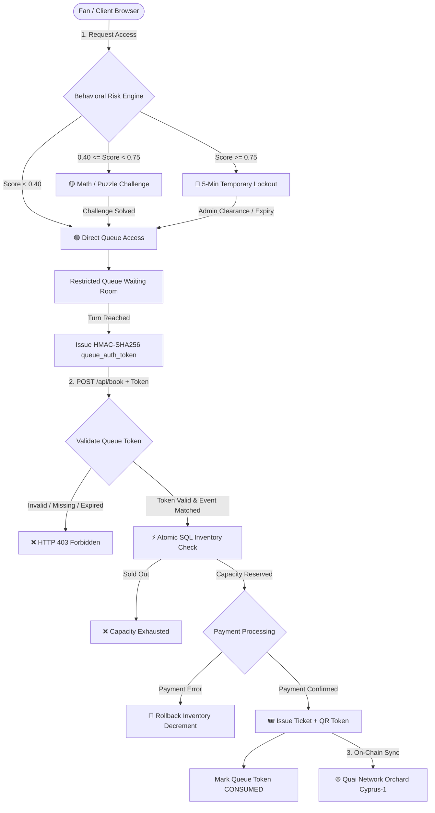
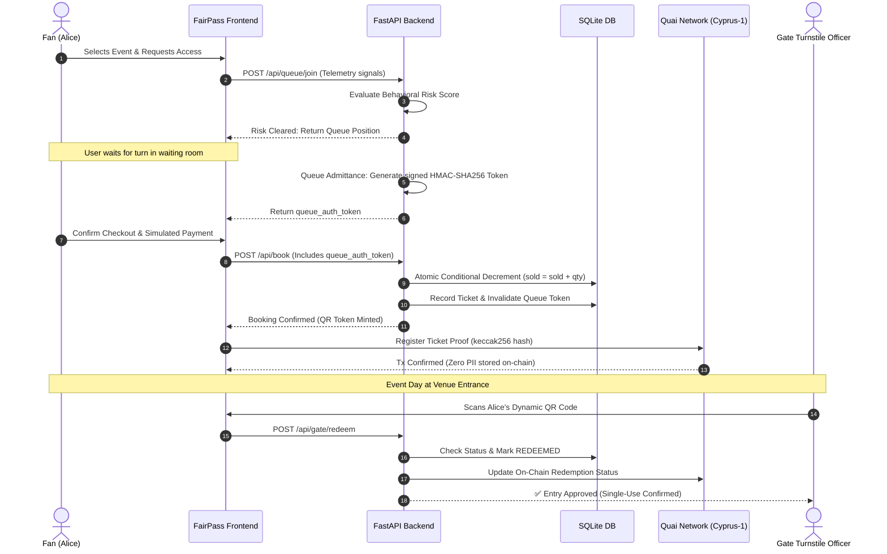
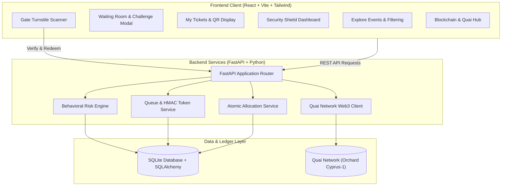

<div align="center">

# 🎟️ FairPass

### **A Fair, Transparent, and Bot-Resistant Ticketing Platform Powered by Behavioral Defense & Quai Network Blockchain Proofs**

[](https://fastapi.tiangolo.com)
[](https://www.python.org)
[](https://react.dev)
[](https://vitejs.dev)
[](https://tailwindcss.com)
[](https://sqlite.org)
[](https://soliditylang.org)
[](https://quai.network)
[](https://metamask.io)
[](#-testing)

<br/>

[Overview](#-project-overview) • [Problem](#-problem-statement) • [Solution](#-our-solution) • [Key Features](#-key-features) • [Security](#-security-architecture) • [How It Works](#-how-fairpass-works) • [Tech Stack](#-technology-stack) • [Blockchain](#-blockchain-integration-quai--evm) • [Architecture](#-project-architecture) • [Screenshots](#-screenshots) • [Setup](#-installation-and-setup) • [Demo Walkthrough](#-how-to-run-the-project) • [Testing](#-testing)

---

</div>

## 📌 Project Overview

**FairPass** is a production-ready fair ticketing platform engineered to eliminate predatory ticket scalping, automated bot sweeps, high-concurrency overselling, and duplicate ticket fraud.

Traditional ticketing fails fans because bots clean out inventory in milliseconds, direct backend APIs can be hit without entering waiting rooms, database race conditions oversell capacity, and resale markets gouge real supporters. 

FairPass combines a **high-speed FastAPI Web2 engine** for seamless sub-second turnstile check-ins with **Quai Network (Orchard Cyprus-1)** for immutable, zero-PII blockchain verification. Every ticket is cryptographically protected from waiting room admittance to final gate turnstile redemption.

---

## 🛑 Problem Statement

| Problem | Real-World Impact | How FairPass Solves It |
| :--- | :--- | :--- |
| **🤖 Automated Bot Sweeps** | Bots submit forms in under 100ms and flood booking APIs with bursts of requests. | **Behavioral Risk Engine** evaluates interaction velocity and rolling request bursts, triggering interactive puzzles or temporary lockouts. |
| **🚪 Queue & API Bypass** | Attackers bypass waiting room UIs and call booking endpoints directly. | **Cryptographic Queue Authorization** mandates an event-specific HMAC-SHA256 token; calls without it are rejected with `HTTP 403`. |
| **⚡ Concurrency Overselling** | Concurrent checkouts cause database race conditions, selling more tickets than venue capacity. | **Atomic Inventory Allocation** combines thread locks (`RLock`) with conditional atomic SQL decrements, verified against 10 simultaneous threads. |
| **📈 Predatory Scalping** | Secondary markets mark up tickets by 300%–1000% of face value. | **Hard Capped Resale (1.1× max)** strictly enforced by backend logic and smart contract price checks. |
| **🎟️ Fake & Cloned Tickets** | Cloned QR screenshots and duplicate gate entries leave genuine buyers stranded. | **Dynamic QR Invalidation**: resold tickets permanently void the seller's QR code and mint a brand-new token for the buyer. |

---

## 💡 Our Solution

FairPass delivers an end-to-end fair ticketing lifecycle centered on four foundational pillars:

```
┌────────────────────────────────────────────────────────────────────────────────────────┐
│                                   FAIRPASS PILLARS                                     │
├───────────────────────┬────────────────────────┬───────────────────────┬───────────────┤
│ 🛡️ BEHAVIORAL SHIELD  │ 🔐 QUEUE AUTHORIZATION │ ⚡ ATOMIC ALLOCATION  │ 🌐 QUAI PROOFS│
│ Multi-signal scoring  │ HMAC-SHA256 signed     │ Thread-safe SQL locks │ Zero-PII      │
│ stops rapid bots and  │ tokens tie access to   │ eliminate race-condi- │ Keccak-256    │
│ burst floods before   │ specific events; zero  │ tion overselling under│ proofs on Quai│
│ booking opens.        │ API bypass permitted.  │ high concurrency.     │ testnet.      │
└───────────────────────┴────────────────────────┴───────────────────────┴───────────────┘
```

---

## ✨ Key Features

### 🛡️ 1. Multi-Signal Behavioral Risk Engine
- **Velocity Detection**: Identifies sub-human submission speeds (< 300ms) and flags them as `MEDIUM` risk.
- **Burst Rate Limiting**: Catches rapid-fire access hits (50+ requests in seconds) and enforces an automatic 5-minute cooldown.
- **Admin Control**: Live risk score telemetry and configurable weights via `/api/admin/security/risk-weights`.

### 🔐 2. Cryptographic Queue Authorization
- **HMAC-SHA256 Signed Tokens**: Upon completing the waiting room, users receive an event-specific token (`FPQA.<payload>.<signature>`).
- **No Direct API Bypasses**: `POST /api/book` strictly verifies the queue token before allocating inventory.
- **Event Isolation & Single-Use**: A token issued for Event A cannot be used on Event B. Once booked, tokens are atomically marked `CONSUMED`.

### ⚡ 3. Atomic Inventory Allocation & Concurrency Protection
- **Thread-Safe Reservation**: Python `threading.RLock` combined with conditional SQL decrements:
  ```sql
  UPDATE events SET sold = sold + :qty WHERE id = :event_id AND (sold + :qty) <= quantity;
  ```
- **Stress-Tested Against Race Conditions**: Verified with 10 simultaneous threads competing for the last 2 tickets — exactly 2 succeed and 8 fail gracefully with zero inventory leakage.
- **Automated Rollback**: Simulated payment failures instantly roll back reserved tickets.

### 🌐 4. Quai Network Integration (Orchard Cyprus-1)
- **Zero-PII Privacy Protection**: Quai Network receives only a cryptographic hash:
  $$\text{ticketHash} = \text{keccak256}(\text{event\_id} + \text{qr\_token} + \text{salt})$$
  No fan names, emails, or phone numbers are ever exposed on-chain.
- **On-Chain Resale & Gate Synchronization**: Smart contract enforces 1.1× resale price caps and updates verification status in real-time when scanned at the gate.

### 🔄 5. Anti-Scalping Capped Resale & Guest Sharing
- **1.1× Price Cap**: Resale prices above 110% of face value are strictly rejected by the backend and smart contract.
- **QR Token Invalidation**: When a ticket is resold, the previous owner's QR code is permanently marked `TRANSFERRED` and a new secure token is minted for the buyer.
- **Non-Permanent Guest Sharing**: Fans can share a ticket with friends via controlled guest passes and revoke access at any time.

### 📱 6. Real-Time Gate Scanner
- **Sub-Second Check-in**: Integrated HTML5 camera QR scanner for venue turnstiles.
- **Anti-Duplication**: Prevents reuse of redeemed tickets with clear `ALREADY REDEEMED` alerts.
- **Automatic Blockchain Sync**: Gate check-ins automatically register on Quai Network.

---

## 🔒 Security Architecture

The FairPass security model protects the booking pipeline through multiple progressive verification stages:



<details>
<summary><b>🔍 Click to view Cryptographic Token Details & Risk Formula</b></summary>

### Queue Authorization Token Format
The queue authorization token follows an HMAC-SHA256 signed envelope:
```
FPQA.<base64_payload>.<base64_signature>
```
**Payload Schema:**
```json
{
  "user_id": 1,
  "email": "alice@example.com",
  "event_id": 4,
  "session_id": "sess_8f21a",
  "issued_at": 1700000000,
  "expires_at": 1700000600
}
```

### Risk Calculation Formula
$$\text{Risk Score} = \min\left(1.0, \sum (w_i \cdot s_i)\right)$$
Where $w_i$ represents configurable weights (rapid click, burst rate, queue retries) and $s_i$ represents normalized signal metrics.
</details>

---

## 🔄 How FairPass Works



---

## 💻 Technology Stack

<div align="center">

| Layer | Technologies Used | Primary Responsibility |
| :--- | :--- | :--- |
| **Frontend** | React 18, Vite 5, Tailwind CSS, Lucide Icons | Responsive UI, state management, interactive demo personas |
| **Backend** | Python 3.10+, FastAPI, Pydantic v2, Uvicorn | High-performance asynchronous REST API & security endpoints |
| **Database** | SQLite, SQLAlchemy 2.0 ORM | Relational persistence, thread-safe inventory decrements |
| **Blockchain (Quai)** | Solidity 0.8.20, Orchard Cyprus-1 Testnet (Chain ID 15000) | Immutable, privacy-preserving zero-PII ownership and redemption proofs |
| **Blockchain (EVM)** | Solidity 0.8.20, Ethers.js v6, MetaMask Extension | Decentralized Web3 wallet connection and contract management |
| **Gate Verification** | HTML5-QRCode, Python Pillow / QRCode | Turnstile camera scanning, dynamic QR generation & validation |

</div>

---

## ⛓️ Blockchain Integration (Quai + EVM)

FairPass implements a **dual-blockchain approach**, leveraging Quai Network for privacy-preserving verification and EVM/MetaMask for Web3 wallet interoperability.

```
                  ┌─────────────────────────────────────────┐
                  │          FAIRPASS BLOCKCHAIN            │
                  └────┬───────────────────────────────┬────┘
                       │                               │
        ┌──────────────▼──────────────┐ ┌──────────────▼──────────────┐
        │  🌐 QUAI NETWORK LAYER      │ │   🦊 EVM / METAMASK LAYER   │
        ├─────────────────────────────┤ ├─────────────────────────────┤
        │ • Orchard Cyprus-1 Testnet  │ │ • Standard EVM Environment  │
        │ • Chain ID: 15000 (0x3a98)  │ │ • MetaMask Browser Wallet   │
        │ • Contract: FairPassQuai.sol│ │ • Contract: FairPass.sol    │
        │ • Zero-PII Keccak-256 Proofs│ │ • Ethers.js v6 Integration │
        │ • On-Chain 1.1x Resale Cap  │ │ • Web3 Identity Connection  │
        │ • Turnstile Gate Redemption │ │ • Public Contract Calls     │
        └─────────────────────────────┘ └─────────────────────────────┘
```

### 1. Quai Network Integration (Orchard Cyprus-1)
- **Zero-PII Privacy Protection**: No user identity (names, emails, wallets) is stored on-chain. Only an irreversible Keccak-256 hash is registered:
  ```solidity
  bytes32 ticketHash = keccak256(abi.encodePacked(eventId, qrToken, salt));
  ```
- **Network Parameters**:
  - **Network**: Quai Orchard Testnet
  - **Zone**: `cyprus1`
  - **Chain ID**: `15000` (`0x3a98`)
  - **RPC Endpoint**: `https://orchard.rpc.quai.network/cyprus1`
  - **Block Explorer**: [https://orchard.quaiscan.io](https://orchard.quaiscan.io)
  - **Smart Contract**: `blockchain/contracts/FairPassQuai.sol`
- **Smart Contract Features**:
  - `registerTicket()`: Registers hashed ticket proof with price cap validation.
  - `redeemTicket()`: Marks ticket redeemed directly from the gate scanner.
  - `verifyTicket()`: Allows anyone to verify ticket authenticity without exposing private data.

### 2. EVM & MetaMask Integration
- **Web3 Wallet Connection**: Connects to user MetaMask wallets using Ethers.js v6.
- **Event Ticketing Contract**: `blockchain/contracts/FairPass.sol` provides standard EVM-compatible minting, transfers, and resale verification.

---

## 🏗️ Project Architecture



<details>
<summary><b>📂 Click to view Repository File Layout</b></summary>

```
FairPass_complete/
├── backend/
│   ├── app/
│   │   ├── main.py                  # FastAPI server & route handlers
│   │   ├── models.py                # SQLAlchemy DB models (Events, Tickets, Risk)
│   │   ├── schemas.py               # Pydantic v2 validation models
│   │   ├── database.py              # SQLite engine, sessions & schema upgrades
│   │   └── services/
│   │       ├── risk_engine.py       # Behavioral risk scoring & weight config
│   │       ├── queue_service.py     # HMAC-SHA256 token generation & validation
│   │       ├── booking_service.py   # Atomic ticket allocation & concurrency guard
│   │       └── quai_service.py      # Quai Network JSON-RPC & Keccak-256 proofs
│   ├── test_fairpass_suite.py       # 28-test automated verification suite
│   ├── requirements.txt             # Backend dependencies
│   └── fairpass.db                  # SQLite database
├── blockchain/
│   ├── contracts/
│   │   ├── FairPassQuai.sol         # Quai Network smart contract
│   │   └── FairPass.sol             # EVM / Ethereum smart contract
│   ├── FairPassQuaiABI.json         # Compiled Quai contract ABI
│   └── FairPassABI.json             # Compiled EVM contract ABI
├── frontend/
│   ├── src/
│   │   ├── App.jsx                  # Main application router & persona state
│   │   ├── components/
│   │   │   ├── Navbar.jsx           # Persona switcher & navigation
│   │   │   ├── EventCard.jsx        # Event display & tag badges
│   │   │   ├── MyTickets.jsx        # Ticket QR display, resale & guest sharing
│   │   │   ├── SecurityDashboard.jsx# Real-time risk logs & weight tuning
│   │   │   ├── GateScanner.jsx      # HTML5 QR turnstile verification
│   │   │   ├── BlockchainCenter.jsx # Quai Network status & contract interactions
│   │   │   ├── RestrictedAccessModal.jsx # Waiting room & puzzle challenge
│   │   │   └── DemoPaymentModal.jsx # Simulated payment checkout
│   ├── package.json                 # Frontend dependencies
│   └── vite.config.js               # Vite configuration
└── docs/
    └── screenshots/                 # Application screenshots & demo assets
```
</details>

---

## 📸 Screenshots

| 🎟️ Explore Events & Discovery | 🛡️ Behavioral Risk Shield |
| :---: | :---: |
| <br/>*Interactive event search, category filters, and live ticket counts.* | <br/>*Live behavioral risk telemetry, triggered signals, and lockout management.* |

| 🔐 Cryptographic Waiting Room | 📱 Turnstile Gate Scanner |
| :---: | :---: |
| <br/>*Fair waiting room issuing signed HMAC-SHA256 queue authorization tokens.* | <br/>*Sub-second QR verification with instant duplicate scan detection.* |

> [!TIP]
> **Adding Your Own Screenshots**: Save your application screenshots to `FairPass_complete/docs/screenshots/` matching the filenames above (`explore-events.png`, `security-shield.png`, etc.) to display them directly on GitHub.

---

## ⚡ Installation and Setup

### Prerequisites
- **Python**: Version `3.10` or higher
- **Node.js**: Version `18.0` or higher
- **Git**: Installed and configured

### 1. Clone the Repository
```bash
git clone https://github.com/rohinicc/Zero_latency.git
cd Zero_latency/FairPass_complete
```

### 2. Backend Setup
```powershell
# Navigate to the backend directory
cd backend

# Create and activate a Python virtual environment
python -m venv .venv

# Windows PowerShell:
.\.venv\Scripts\Activate.ps1
# macOS / Linux:
# source .venv/bin/activate

# Install required dependencies
pip install -r requirements.txt
```

### 3. Frontend Setup
```powershell
# Open a new terminal and navigate to the frontend directory
cd frontend

# Install dependencies
npm install
```

---

## 🚀 How to Run the Project

### Start Backend Server
```powershell
cd backend
.\.venv\Scripts\Activate.ps1
uvicorn app.main:app --reload --port 8000
```
- API Base URL: `http://127.0.0.1:8000`
- Interactive OpenAPI / Swagger Docs: `http://127.0.0.1:8000/docs`

### Start Frontend Application
```powershell
cd frontend
npm run dev
```
- Frontend Web App: `http://localhost:5173`

---

## 🎭 Interactive Demo Walkthrough

FairPass includes built-in demo personas for testing real-world scenarios in seconds:

| Demo Persona | Role | Primary Objective |
| :--- | :--- | :--- |
| 👩 **Alice Sharma** (`alice@example.com`) | Fan & Primary Buyer | Clear queue, book tickets, register proofs on Quai, share guest passes |
| 👨 **Bob Patel** (`bob@example.com`) | Resale Buyer | Purchase resold tickets under the 1.1× cap with newly minted QR codes |
| 👦 **Charlie Rao** (`charlie@example.com`) | Guest Attendee | Receive revocable guest passes without permanent ownership transfer |
| 🛡️ **FairPass Organizer** (`admin@fairpass.io`) | Admin & Gate Officer | Monitor live risk logs, adjust risk weights, check in tickets at turnstile |

<details>
<summary><b>🎬 Step-by-Step Testing Scenarios for Evaluators</b></summary>

### Scenario 1 — Behavioral Risk Challenge
1. Select **Alice Sharma** from the top navbar persona dropdown.
2. Click any event to open the **Restricted Access Window**.
3. Under *Testing Tools*, click **Simulate Rapid Bot (<200ms)**.
4. The Risk Engine detects sub-human velocity, classifies it as `MEDIUM`, and displays an interactive verification challenge.
5. Solve the challenge to enter the waiting room.

### Scenario 2 — 50-Request Burst Lockout & Admin Lift
1. In the Restricted Access Window, click **Simulate 50+ Burst Lockout**.
2. The engine catches the rapid access burst, classifies it as `HIGH`, and enforces a 5-minute cooldown with a live countdown timer.
3. Switch persona to **FairPass Organizer** and navigate to the **Security Shield** tab.
4. Review the behavioral logs, triggered signals, and active restriction record.
5. Click **Lift Restriction** to immediately restore account access.

### Scenario 3 — Queue Authorization Token & Atomic Booking
1. Enter an event with the queue enabled.
2. Advance through the waiting room. Upon admittance, an event-specific HMAC-SHA256 `queue_auth_token` is generated.
3. Select quantity, enter the simulated payment modal, and confirm checkout.
4. The backend verifies the token and atomically decrements inventory.

### Scenario 4 — Quai Network Proof Verification
1. Navigate to the **Web3 & Quai** tab.
2. Click **Test Quai RPC Health** to probe the Orchard Cyprus-1 endpoint.
3. In the **Verify Ticket Proof on Quai** tool, enter Ticket ID `#1` and click **Verify on Quai**.
4. Review the Keccak-256 `ticketHash`, on-chain status, and link to [QuaiScan Explorer](https://orchard.quaiscan.io).
5. In **My Tickets**, observe the purple **Quai Cyprus-1 Confirmed** badge.

### Scenario 5 — 1.1× Capped Resale & QR Invalidation
1. As **Alice Sharma**, open **My Tickets** and click **Resell** on an active ticket.
2. Enter a price below the 1.1× cap (e.g. ₹2,100 on a ₹2,000 ticket) and recipient `bob@example.com`.
3. Complete simulated resale.
4. Switch persona to **Bob Patel**: Bob now possesses the ticket with a brand-new QR code.
5. Open the **Gate Scanner** and scan Alice's old QR token: it reports **INVALIDATED (TRANSFERRED)**.
</details>

---

## 🧪 Testing

The automated test suite runs **28 end-to-end integration and concurrency tests**:

```powershell
cd backend
.\.venv\Scripts\Activate.ps1
python test_fairpass_suite.py
```

```
======================================================================
🎉 ALL 28 TESTS PASSED SUCCESSFULLY! ALL 4 UPGRADES FULLY VALIDATED.
======================================================================
```

### Complete Test Coverage Matrix

| # | Test Name | Target Component | Result |
| :---: | :--- | :--- | :---: |
| 1 | Health check & API availability | System Core | `PASS` |
| 2 | Demo persona accounts availability | Authentication | `PASS` |
| 3 | Event discovery & filtering | Event Catalog | `PASS` |
| 4 | Organizer event creation with custom 1.1× cap | Event Management | `PASS` |
| 5 | Event persistence & verification | Database | `PASS` |
| 6 | Event editing & capacity updates | Event Management | `PASS` |
| 7 | **Behavioral Risk**: Rapid submission (< 200ms -> MEDIUM) | Risk Engine | `PASS` |
| 8 | **Behavioral Risk**: 50+ burst attack lockout (HIGH) | Risk Engine | `PASS` |
| 9 | **Behavioral Risk**: Audit telemetry persistence | Database Logging | `PASS` |
| 10 | **Behavioral Risk**: Configurable weights & thresholds API | Admin Security API | `PASS` |
| 11 | **Behavioral Risk**: Administrator lockout clearance | Admin Security API | `PASS` |
| 12 | Queue entry without refundable deposits | Waiting Room | `PASS` |
| 13 | **Queue Auth**: Cryptographic HMAC-SHA256 token issuance | Queue Service | `PASS` |
| 14 | **Queue Auth**: Direct API bypass rejection (HTTP 403) | Security Middleware | `PASS` |
| 15 | **Queue Auth**: Cross-event token reuse prevention | Security Middleware | `PASS` |
| 16 | **Queue Auth**: Expired token rejection | Security Middleware | `PASS` |
| 17 | **Atomic Booking**: Valid booking with token succeeds | Booking Service | `PASS` |
| 18 | **Atomic Booking**: Single-use token invalidation | Booking Service | `PASS` |
| 19 | **Atomic Booking**: Payment failure inventory rollback | Booking Service | `PASS` |
| 20 | **Concurrency Stress**: 10 threads competing for 2 tickets | Concurrency Guard | `PASS` |
| 21 | **Quai Network**: Zero-PII Keccak-256 ticketHash generation | Quai Service | `PASS` |
| 22 | **Quai Network**: Chain ID 15000 & Cyprus-1 config | Quai Service | `PASS` |
| 23 | **Quai Network**: RPC health check probe | Quai Service | `PASS` |
| 24 | **Quai Network**: Proof registration on Orchard testnet | Quai Contract | `PASS` |
| 25 | **Quai Network**: On-chain verification query | Quai Contract | `PASS` |
| 26 | **Quai Network**: Gate redemption synced to Quai state | Quai Contract | `PASS` |
| 27 | Resale price cap (1.1× max) backend enforcement | Anti-Scalping | `PASS` |
| 28 | Non-permanent guest pass sharing & revocation | Guest Passes | `PASS` |

> [!NOTE]
> **Concurrency Test Highlight (Test #20)**: Under 10 simultaneous threads competing for only 2 remaining tickets, exactly 2 requests succeeded and 8 failed gracefully with zero overselling, confirming thread-safe inventory decrements.

---

## 🔮 Future Improvements

- [ ] **Decentralized Fan Identity (DID)**: Integrating Quai-native decentralized identity proofs for sybil resistance.
- [ ] **Offline Turnstile Verification**: Utilizing zero-knowledge client proofs for gate validation during venue network outages.
- [ ] **Dynamic Face-Value Curves**: Automated algorithmic price controls adjusting to demand spikes while maintaining the hard resale cap.
- [ ] **Native Mobile Gate App**: Dedicated iOS and Android scanner applications using Quai light client proofs.

---

## 👥 Contributors

- **Rohini C** — Lead Full-Stack, Security & Blockchain Engineer

---

<div align="center">

Made with ❤️ for fair, transparent, and scalper-free events everywhere.

**FairPass** • *Fair Ticketing for Everyone*

</div>
